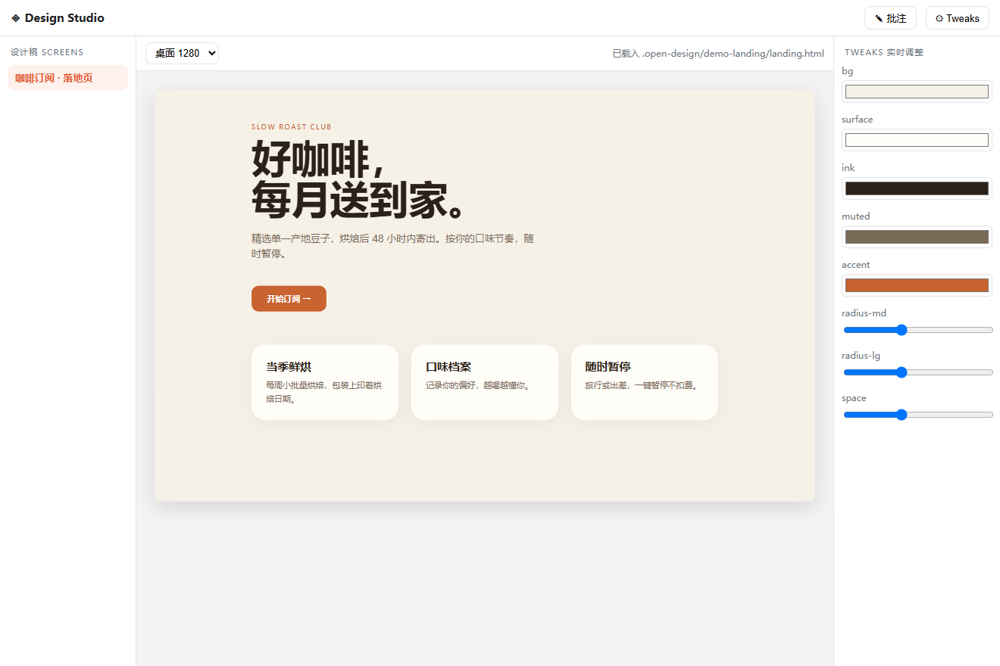

<div align="center">

# codex-design-studio

**把 DSH 式的设计工作台，装进 Codex 的侧栏。**

模型画的界面摆上画布，点一下就改，还能拖滑杆实时调风格。


</div>

## 这是什么

一个 [Codex](https://developers.openai.com/codex) 插件（MCP App），把设计工作台直接开在 Codex 的侧栏里。它读取你项目里的 HTML 设计稿（例如 [Open Design Agent Kit](https://github.com/feimacode/open-design-agent-kit) 生成的产物），放进带设备框的画布，让你像用 DSH 设计工作台那样看效果、点选元素提修改、拖滑杆调样式。

> 需要 Codex 桌面端：侧栏 UI 是 Codex 应用的功能，纯 CLI 里没有侧栏。

## 效果预览



左侧是设计稿列表，中间是按桌面 / 平板 / 手机尺寸渲染的真实页面，右侧 Tweaks 面板可直接调整颜色、圆角和间距。

## 功能

- **侧栏画布**：原生 MCP App，直接开在 Codex 侧栏，无需浏览器或端口
- **多屏切换**：自动扫描项目里的 HTML，逐屏列出
- **设备框预览**：桌面 1280 / 平板 768 / 手机 390 三档
- **点选批注**：开启批注模式后点页面任意元素，自动记录 CSS 选择器、位置、源码路径，并生成一条发给 Codex 的精确修改指令
- **Tweaks 滑杆**：读取 `:root` 下的 CSS 变量，颜色用拾色器、间距圆角用滑杆，改动实时预览并写回 HTML
- **安全边界**：只能读写项目目录内的文件；所有改动都是普通文件编辑，可用 git 撤销

## 快速开始

### 1. 安装插件

插件本体就在本仓库根目录。把它放到你的长期目录，并链接到 Codex 的插件目录：

```powershell
# Windows（把路径换成你克隆的位置）
New-Item -ItemType Junction -Path "$env:USERPROFILE\plugins\codex-design-studio" -Target "C:\path\to\codex-design-studio\plugin"
```

然后编辑 `$env:USERPROFILE\.agents\plugins\marketplace.json`，在 `plugins` 数组里加：

```json
{
  "name": "codex-design-studio",
  "source": { "source": "local", "path": "./plugins/codex-design-studio" },
  "policy": { "installation": "AVAILABLE", "authentication": "ON_INSTALL" },
  "category": "Design"
}
```

> 注意：这个文件必须是**无 BOM 的 UTF-8**。带 BOM 会导致 Codex 报 `invalid marketplace file`。

最后启用：

```bash
codex plugin add codex-design-studio@personal
```

macOS / Linux 用软链接代替 junction：

```bash
ln -s /absolute/path/to/codex-design-studio/plugin ~/.codex/plugins/codex-design-studio
```

### 2. 试一下

本仓库的 `demo/` 是一个可直接运行的演示工程，已配好 MCP 和设计稿：

```bash
cd demo
codex
```

在对话里说：**「打开设计工作台」**。侧栏就会出现上面的界面，并自动列出 `demo/.open-design/demo-landing/landing.html`。

### 3. 用在自己的项目

把 `demo/.codex/config.toml` 里的 MCP 配置和 `demo/.agents/skills/` 拷到你的项目，让 Codex 能调用 `open_design_studio`；然后说「打开设计工作台」，并给出项目目录。

也可以先装 [Open Design Agent Kit](https://github.com/feimacode/open-design-agent-kit) 生成设计稿，再用本插件查看和修改：

```
npx @feimacode/open-design-agent-kit init --tools codex
```

## 它怎么工作

- `open_design_studio`：注册一个 `ui://` 资源，作为 Codex 侧栏的 MCP App 打开
- `list_designs`：扫描项目里的 HTML 设计文件
- `design_app_request`：工作台 UI 的私有传输通道，负责读文件、写批注、应用 Tweak

工作台前端是一个独立的 MCP App 组件，通过 `ui/*` 桥接（基于 [`@modelcontextprotocol/ext-apps`](https://github.com/modelcontextprotocol/ext-apps)）与宿主通信。

## 从源码构建

```bash
cd plugin
npm install
npm run build      # 重新打包 public/workbench.html
npm test           # MCP server 端到端测试
```

构建用 esbuild 把通信 SDK 内联进单个 HTML，避免运行时的额外依赖。

## 常见问题

- **侧栏没出现？** 确认你用的是 Codex 桌面端而不是 CLI；CLI 没有侧栏 UI。
- **`invalid marketplace file`？** `marketplace.json` 有 BOM，转成无 BOM UTF-8。
- **改了源码没生效？** Codex 装的是缓存副本。先 `codex plugin remove codex-design-studio@personal`，再重新 `codex plugin add codex-design-studio@personal`。
- **Tweaks 看不到控件？** 设计稿要把样式写成 `:root` 下的 CSS 变量；硬编码的值不会被识别，先用变量改造。
- **看不到设计稿？** 说「打开设计工作台」时给出绝对项目目录；插件只扫描项目目录内的 HTML。

## 限制

- 需要 Codex 桌面端；不兼容纯 CLI 或其他 MCP 客户端的侧栏（它们没有 `ui://` App 承载）
- 点选批注是「精确描述 + 生成指令」，具体修改仍由 Codex 执行，不是像 Figma 那样的直接 DOM 编辑
- Tweaks 只作用于 CSS 变量，硬编码样式需先 token 化
- 目前未内置多版本对比、设计市场、逐像素 diff；这些是后续方向

<!-- jack-white-rice-support:start -->
## 请大肥鱼吃大白饭 🍚

如果这个项目帮到了你，欢迎请大肥鱼吃一碗大白饭。自愿投喂，量力而行，感谢支持！

<p>
  <a href="assets/support/alipay-jack-v1.jpg"></a>
  <a href="assets/support/rice-meme-v1.png"></a>
</p>
<!-- jack-white-rice-support:end -->

## 许可

MIT — 见 [LICENSE](LICENSE)。
